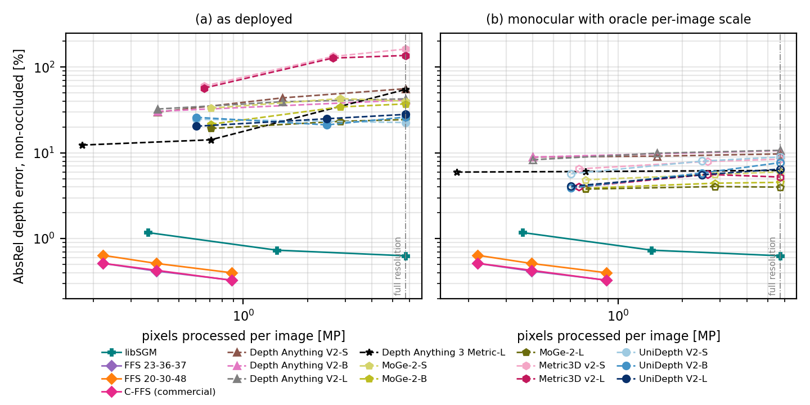
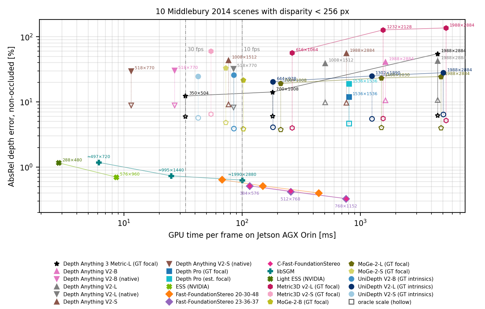
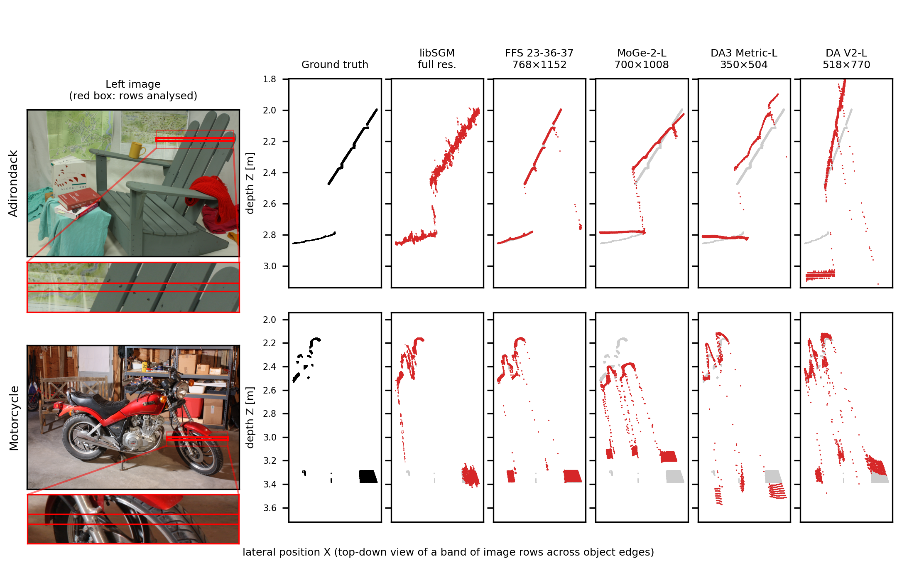
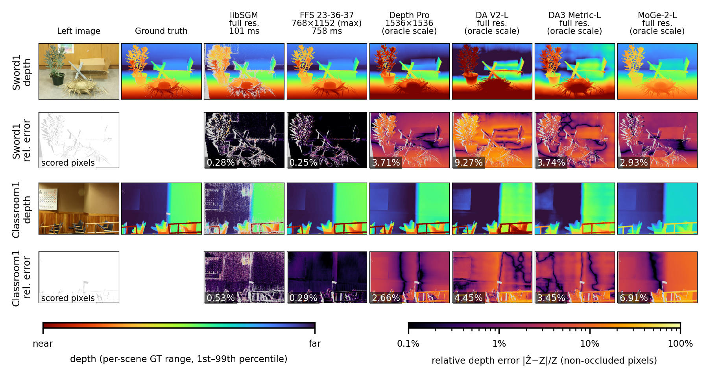
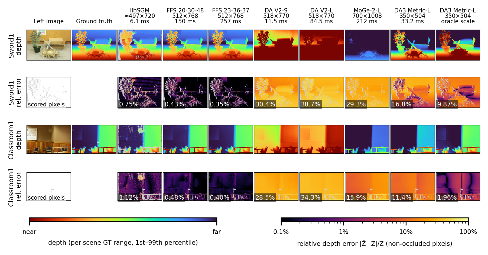

# Which Depth Estimator for Jetson AGX Orin?
### A 2026 benchmark of monocular and stereo methods

Code, raw results and LaTeX source for the paper

> **Which Depth Estimator for Jetson AGX Orin? A 2026 Benchmark of Monocular and Stereo Methods**
> Leaf Jiang, NODAR Inc. *(arXiv link to be added)* — [PDF](paper/main.pdf)

Measured accuracy, speed and energy of current depth estimators on the NVIDIA Jetson AGX Orin are hard
to find. We run nine model families as of October 2026 on a **Jetson AGX Orin 64GB** (MAXN, TensorRT 10.3
FP16, or native CUDA), each at up to three input sizes up to the full 5.7 MP, and score **metric
accuracy** against **Middlebury 2014** ground truth (non-occluded pixels of the 10 scenes whose disparity
stays below 256 px), together with **GPU time**, **energy** and **licence**.

## Which method to use

Most accurate configuration (AbsRel, lower is better) whose GPU time on one Orin fits each frame-rate
budget; monocular models with the true focal length / intrinsics. The last row is the lowest GPU time among
methods whose licences permit commercial use and modification.

| Budget (one AGX Orin) | Best stereo | Best monocular | Best monocular, oracle scale |
|---|---|---|---|
| 30 fps | ESS (NVIDIA), 576×960: 0.70% (9 ms) | Depth Anything 3 Metric-L, 350×504: 12.34% (33 ms) | Depth Anything 3 Metric-L, 350×504: 5.97% (33 ms) |
| 10 fps | Fast-FoundationStereo 20-30-48, 384×576: 0.64% (68 ms) | Depth Anything 3 Metric-L, 350×504: 12.34% (33 ms) | UniDepth V2-B, 644×938: 3.90% (85 ms) |
| 1 fps | C-Fast-FoundationStereo, 768×1152: 0.33% (760 ms) | Depth Pro, 1536×1536: 11.98% (803 ms) | MoGe-2-L, 700×1008: 3.78% (212 ms) |
| no limit | C-Fast-FoundationStereo, 768×1152: 0.33% (760 ms) | Depth Pro, 1536×1536: 11.98% (803 ms) | MoGe-2-L, 700×1008: 3.78% (212 ms) |
| lowest GPU, open source | libSGM, ≈497×720: 1.18% (6 ms) | Depth Anything V2-S (native), 518×770: 29.88% (12 ms) | Depth Anything V2-S (native), 518×770: 8.93% (12 ms) |

* **Two cameras:** at 30 fps, NVIDIA's **ESS** (0.70 %, dense, 8.6 ms) or Light ESS (1.16 %, 2.8 ms); open source, **libSGM** at half resolution (0.73 % on 85 % of pixels, 25 ms) or, for the lowest GPU load, at quarter resolution (1.18 %, 6.1 ms, 0.18 J). With more compute, **Fast-FoundationStereo** reaches 0.33 %; its research checkpoints are non-commercial, but the commercially licensed **C-Fast-FoundationStereo** is as accurate (0.33 % at 768×1152, 760 ms).
* **One camera:** no monocular model is close in metric accuracy. Depth Anything 3 Metric-L (12.3 %, 33 ms) and Depth Pro (12.0 %, 803 ms) are the most accurate with the true focal length; with an externally supplied scale, MoGe-2-L, UniDepth V2-B and Metric3D v2-L reach 3.8–4.0 %. Running monocular models above their native input does not help.

## Methods

| Method | Type | Processing resolution | Licence (as stated by the authors) |
|---|---|---|---|
| [libSGM](https://github.com/fixstars/libSGM) 3.1.0, 4 paths, P1/P2 tuned per resolution | classical stereo (SGM, CUDA) | full (≈1990×2880), half, quarter | Apache-2.0 |
| [ESS / Light ESS](https://catalog.ngc.nvidia.com/orgs/nvidia/teams/isaac/models/dnn_stereo_disparity) 4.1.0 (NVIDIA Isaac ROS) | learned stereo | 576×960 / 288×480 (fixed) | NVIDIA TAO model EULA (commercial use permitted) |
| [Fast-FoundationStereo](https://github.com/NVlabs/Fast-FoundationStereo) (2 research checkpoints) | learned stereo | 384×576, 512×768, 768×1152 (max on the Orin) | NVIDIA Source Code License (non-commercial) |
| [C-Fast-FoundationStereo](https://huggingface.co/nvidia/c-fast-foundationstereo) (commercial checkpoint, architecture of 23-36-37) | learned stereo | 384×576, 512×768, 768×1152 | NVIDIA Open Model Agreement |
| [Depth Pro](https://github.com/apple/ml-depth-pro) | monocular | 1536×1536 (fixed) | Apple licence |
| [Depth Anything V2](https://github.com/DepthAnything/Depth-Anything-V2) metric (Hypersim) S/B/L | monocular | native 518×770, 1008×1512 (S, L), full 1988×2884 | S: Apache-2.0; B, L: CC BY-NC 4.0 |
| [Depth Anything 3](https://github.com/ByteDance-Seed/Depth-Anything-3) Metric-Large | monocular | native 350×504, 700×1008, full | Apache-2.0 |
| [MoGe-2](https://github.com/microsoft/MoGe) S/B/L | monocular | native ≈700×1008, 1400×2030, full | MIT |
| [Metric3D v2](https://github.com/YvanYin/Metric3D) ViT-S/L | monocular | native 616×1064, 1232×2128, full | BSD-2-Clause |
| [UniDepth V2](https://github.com/lpiccinelli-eth/UniDepth) S/B/L | monocular | native 644×938, 1302×1890, full | CC BY-NC 4.0 |

Licences are reported as the authors state them; this is not legal advice.

## Key results

* **Stereo is far more accurate.** Every stereo configuration, raw or hole-filled, is more accurate than every monocular one, even when the monocular depth is rescaled with an *oracle* per-image scale (worst stereo: hole-filled libSGM at quarter resolution, 2.13 % AbsRel; best oracle-scaled monocular: MoGe-2-L, 3.78 %).
* **Stereo improves with resolution; monocular models do not.** libSGM: 1.18 % → 0.73 % → 0.63 % from quarter to full resolution; Fast-FoundationStereo: 0.51 % → 0.42 % → 0.33 % from 0.2 to 0.9 MP. The monocular models' metric scale drifts outside their training resolution (e.g. Depth Anything 3: 12.3 % → 54.9 %; Metric3D v2 places most of the scene beyond the zero-disparity distance at 2× and full size), and their oracle-scaled shape error stays flat or grows.
* **Edges, which AbsRel barely sees:** at depth discontinuities (1.7 % of pixels) the monocular models place 17–46 % of the points between foreground and background; learned stereo 2–9 %; libSGM at full resolution 1.1 %, the cleanest of all, at the cost of missing pixels.
* **Stereo is also the cheaper computation:** Light ESS 2.8 ms, libSGM at quarter resolution 6.1 ms and ESS 8.6 ms per frame, against 11.5 ms to 5.3 s for the monocular models.



## Full results

Non-occluded ground truth, 10 Middlebury 2014 scenes, Jetson AGX Orin 64GB, MAXN, TensorRT 10.3 FP16:

<!-- RESULTS_TABLE_START -->
| Method | Resolution | Dens. % | bad-2 % | AbsRel % | AbsRel % oracle scale | GPU ms | J/frame |
|---|---|---:|---:|---:|---:|---:|---:|
| Light ESS (NVIDIA) | 288×480 (fixed) | 100 | 36.9 | 1.16 | -- | 2.8 | 0.08 |
| libSGM | ≈497×720 (quarter) | 88 | 31.3 | 1.18 | -- | 6.1 | 0.18 |
| libSGM (hole-filled) | ≈497×720 (quarter) | 100 | 28.4 | 2.13 | -- | 6.1 | 0.18 |
| ESS (NVIDIA) | 576×960 (fixed) | 100 | 20.4 | 0.70 | -- | 8.6 | 0.31 |
| libSGM | ≈995×1440 (half) | 85 | 24.7 | 0.73 | -- | 25.1 | 0.73 |
| libSGM (hole-filled) | ≈995×1440 (half) | 100 | 20.2 | 1.79 | -- | 25.1 | 0.73 |
| Fast-FoundationStereo 20-30-48 | 384×576 | 100 | 17.0 | 0.64 | -- | 67.7 | 1.88 |
| libSGM | full (≈1990×2880) | 76 | 32.1 | 0.63 | -- | 100.6 | 2.96 |
| libSGM (hole-filled) | full (≈1990×2880) | 100 | 22.3 | 1.92 | -- | 100.6 | 2.96 |
| Fast-FoundationStereo 23-36-37 | 384×576 | 100 | 12.7 | 0.51 | -- | 115.6 | 3.32 |
| C-Fast-FoundationStereo | 384×576 | 100 | 12.9 | 0.52 | -- | 115.7 | 3.29 |
| Fast-FoundationStereo 20-30-48 | 512×768 | 100 | 12.4 | 0.51 | -- | 149.7 | 4.23 |
| Fast-FoundationStereo 23-36-37 | 512×768 | 100 | 8.9 | 0.42 | -- | 257.5 | 7.43 |
| C-Fast-FoundationStereo | 512×768 | 100 | 9.4 | 0.43 | -- | 257.6 | 7.39 |
| Fast-FoundationStereo 20-30-48 | 768×1152 (max) | 100 | 8.5 | 0.40 | -- | 444.7 | 12.93 |
| Fast-FoundationStereo 23-36-37 | 768×1152 (max) | 100 | 6.5 | 0.33 | -- | 758.1 | 22.39 |
| C-Fast-FoundationStereo | 768×1152 (max) | 100 | 6.0 | 0.33 | -- | 760.4 | 21.95 |
| Depth Anything V2-S (native) | 518×770 (native) | 100 | 98.1 | 29.88 | 8.93 | 11.5 | 0.50 |
| Depth Anything V2-B (native) | 518×770 (native) | 100 | 98.5 | 30.55 | 8.93 | 26.8 | 1.32 |
| Depth Anything 3 Metric-L (GT focal) | 350×504 (native) | 93 | 95.0 | 12.34 | 5.97 | 33.2 | 1.69 |
| UniDepth V2-S (GT intrinsics) | 644×938 (native) | 93 | 98.4 | 24.67 | 5.71 | 42.5 | 1.72 |
| Metric3D v2-S (GT focal) | 616×1064 (native) | 65 | 98.8 | 60.06 | 6.51 | 54.5 | 2.01 |
| MoGe-2-S (GT focal) | 700×1008 (native) | 76 | 98.5 | 33.26 | 4.86 | 72.6 | 2.77 |
| MoGe-2-S (est. focal) | 700×1008 (native) | 100 | 97.7 | 30.33 | 9.06 | 72.6 | 2.77 |
| Depth Anything V2-S | 1008×1512 | 100 | 99.9 | 43.79 | 9.17 | 76.6 | 3.40 |
| Depth Anything V2-L (native) | 518×770 (native) | 100 | 98.5 | 32.46 | 8.31 | 84.5 | 4.12 |
| UniDepth V2-B (GT intrinsics) | 644×938 (native) | 84 | 98.6 | 25.99 | 3.90 | 85.0 | 3.69 |
| MoGe-2-B (GT focal) | 700×1008 (native) | 96 | 97.5 | 21.58 | 3.88 | 102.6 | 4.19 |
| MoGe-2-B (est. focal) | 700×1008 (native) | 100 | 99.7 | 36.41 | 7.53 | 102.6 | 4.19 |
| Depth Anything 3 Metric-L (GT focal) | 700×1008 | 90 | 96.8 | 14.21 | 6.07 | 181.3 | 8.56 |
| UniDepth V2-L (GT intrinsics) | 644×938 (native) | 99 | 96.4 | 20.47 | 4.09 | 182.1 | 8.28 |
| MoGe-2-L (GT focal) | 700×1008 (native) | 94 | 95.8 | 19.24 | 3.78 | 211.6 | 9.28 |
| MoGe-2-L (est. focal) | 700×1008 (native) | 100 | 98.6 | 39.87 | 9.01 | 211.6 | 9.28 |
| Metric3D v2-L (GT focal) | 616×1064 (native) | 63 | 100.0 | 56.93 | 4.00 | 265.3 | 11.97 |
| UniDepth V2-S (GT intrinsics) | 1302×1890 | 95 | 97.5 | 23.37 | 8.02 | 279.1 | 12.22 |
| Metric3D v2-S (GT focal) | 1232×2128 | 14 | 100.0 | 133.00 | 7.94 | 295.6 | 12.11 |
| MoGe-2-S (GT focal) | 1400×2030 | 68 | 98.5 | 42.94 | 5.60 | 418.7 | 16.71 |
| MoGe-2-S (est. focal) | 1400×2030 | 100 | 99.8 | 36.67 | 9.75 | 418.7 | 16.71 |
| Depth Anything V2-L | 1008×1512 | 100 | 99.6 | 39.46 | 9.92 | 502.7 | 23.54 |
| UniDepth V2-B (GT intrinsics) | 1302×1890 | 95 | 96.8 | 21.21 | 5.83 | 579.6 | 25.47 |
| MoGe-2-B (GT focal) | 1400×2030 | 86 | 99.1 | 34.36 | 4.43 | 663.4 | 28.11 |
| MoGe-2-B (est. focal) | 1400×2030 | 100 | 99.7 | 37.07 | 8.26 | 663.4 | 28.11 |
| Depth Anything V2-S | 1988×2884 (full) | 100 | 100.0 | 56.04 | 9.73 | 761.6 | 31.70 |
| Depth Pro (GT focal) | 1536×1536 (fixed) | 98 | 95.9 | 11.98 | 4.70 | 802.5 | 38.68 |
| Depth Pro (est. focal) | 1536×1536 (fixed) | 95 | 99.4 | 18.95 | 4.70 | 802.5 | 38.68 |
| Metric3D v2-S (GT focal) | 1988×2884 (full) | 5 | 100.0 | 162.46 | 8.44 | 992.3 | 41.69 |
| UniDepth V2-S (GT intrinsics) | 1988×2884 (full) | 96 | 98.2 | 22.57 | 8.96 | 1,133.3 | 50.43 |
| MoGe-2-S (GT focal) | 1988×2884 (full) | 66 | 94.8 | 40.23 | 6.00 | 1,178.6 | 48.76 |
| MoGe-2-S (est. focal) | 1988×2884 (full) | 100 | 99.3 | 41.33 | 9.99 | 1,178.6 | 48.76 |
| UniDepth V2-L (GT intrinsics) | 1302×1890 | 100 | 98.3 | 25.02 | 5.55 | 1,250.1 | 56.50 |
| MoGe-2-L (GT focal) | 1400×2030 | 87 | 97.1 | 23.36 | 4.05 | 1,503.3 | 67.23 |
| MoGe-2-L (est. focal) | 1400×2030 | 100 | 99.1 | 40.65 | 9.33 | 1,503.3 | 67.23 |
| Metric3D v2-L (GT focal) | 1232×2128 | 9 | 100.0 | 127.52 | 5.61 | 1,558.6 | 70.16 |
| Depth Anything V2-B | 1988×2884 (full) | 100 | 100.0 | 41.24 | 10.64 | 1,628.4 | 72.17 |
| MoGe-2-B (GT focal) | 1988×2884 (full) | 81 | 99.0 | 37.23 | 4.54 | 2,007.0 | 86.64 |
| MoGe-2-B (est. focal) | 1988×2884 (full) | 100 | 99.6 | 36.32 | 8.35 | 2,007.0 | 86.64 |
| UniDepth V2-B (GT intrinsics) | 1988×2884 (full) | 96 | 99.4 | 26.18 | 7.69 | 2,335.2 | 103.84 |
| Depth Anything V2-L | 1988×2884 (full) | 100 | 99.7 | 42.69 | 10.72 | 4,496.9 | 202.70 |
| Depth Anything 3 Metric-L (GT focal) | 1988×2884 (full) | 56 | 100.0 | 54.88 | 6.24 | 4,503.7 | 201.72 |
| MoGe-2-L (GT focal) | 1988×2884 (full) | 86 | 99.1 | 24.45 | 3.99 | 4,817.9 | 214.81 |
| MoGe-2-L (est. focal) | 1988×2884 (full) | 100 | 98.6 | 39.67 | 9.17 | 4,817.9 | 214.81 |
| UniDepth V2-L (GT intrinsics) | 1988×2884 (full) | 100 | 100.0 | 28.10 | 6.48 | 5,047.5 | 226.71 |
| Metric3D v2-L (GT focal) | 1988×2884 (full) | 8 | 100.0 | 136.76 | 5.23 | 5,297.5 | 235.45 |

*AbsRel is over predicted pixels; raw libSGM output is sparse (density column), "hole-filled" uses MiddEval3-style background filling. "Oracle scale": monocular depth multiplied by the per-image median GT/prediction ratio. "GT focal / intrinsics": the monocular model is given the true camera. Generated by `scripts/score_v2.py` and `scripts/make_figures_v2.py`; system cost and break-even camera prices are in `results/v2/breakeven.csv` and `paper/tables/v2_cost.tex`.*
<!-- RESULTS_TABLE_END -->



Point clouds at object edges, seen from above (each method at its own output resolution, monocular depth with oracle scale):



Depth and relative-error maps at full resolution (monocular with oracle scale) and at low resolution (each method as deployed):




## Repository layout

```
common/                 Middlebury I/O, metrics, TensorRT runner, power sampling, attention export helper
methods/
  libsgm/               build script + C shim (ctypes), accuracy (run.py), speed (bench.py),
                        P1/P2 grid search with leave-one-scene-out check (tune.py, tuned.py)
  ess/                  NVIDIA ESS / Light ESS accuracy (TensorRT engines with the ESS plugin library)
  depth_anything_v2/    ONNX export
  depth_pro/            ONNX export
  da3/                  Depth Anything 3 Metric-L: FP32 accuracy, ONNX export, engine check
  moge2/                MoGe-2 S/B/L: FP32 accuracy, ONNX export, engine check
  metric3d/             Metric3D v2 ViT-S/L: FP32 accuracy, ONNX export
  unidepth/             UniDepth V2 S/B/L: FP32 accuracy, ONNX export
scripts/
  setup_jetson.sh         venv + third-party repos (pinned in third_party.lock) + weights
  download_middlebury.sh  Middlebury 2014 ("perfect" calibration)
  export_and_build.sh     ONNX export + TensorRT FP16 engine builds
  eval_networks.py        accuracy of a TensorRT engine (or FP32 PyTorch) on Middlebury
  check_trt_vs_torch.py   FP16 TensorRT vs FP32 PyTorch (Depth Anything V2, Depth Pro)
  check_new_engines.py    FP16 TensorRT vs FP32 PyTorch (Metric3D v2, UniDepth V2)
  bench_speed.py          trtexec latency/throughput + tegrastats power
  nsys_frame_stats.py     per-frame GPU busy time from an Nsight Systems trace
  score_v2.py             main evaluation: 10 scenes, non-occluded GT, raw + hole-filled
  make_figures_v2.py      accuracy table, accuracy-vs-GPU-time figure, cost model, README table
  make_recommendations.py best configuration per frame-rate budget (paper Table 2)
  make_scaling_figure.py  resolution-scaling figure + monocular scale-drift table
  edge_analysis.py        depth discontinuities: flying points + point-cloud figure
  make_depth_figure.py    depth / error-map figures (--set main: full resolution, --set lowres)
  make_dataset_table.py   appendix scene table with thumbnails
  run_all.sh              the whole pipeline
results/
  v2/                     summary, per-scene, edge, recommendation and break-even results used in the paper
  libsgm_tuning/          P1/P2 grid search per resolution, incl. leave-one-scene-out
  speed/                  GPU time and power per method
paper/                    LaTeX source of the paper (arXiv)
```

## Reproducing the results

### Hardware / software
* NVIDIA Jetson AGX Orin 64GB developer kit, JetPack 6.2 (L4T R36.4.3), CUDA 12.6, TensorRT 10.3, power mode **MAXN**
* Python 3.10, PyTorch 2.8.0 (Jetson build from `pypi.jetson-ai-lab.io`, used for ONNX export and FP32 reference accuracy)
* Nsight Systems (libSGM GPU-busy timing); ~60 GB free disk

### 1. Setup (on the Jetson)
```bash
git clone https://github.com/nodarhub/orin-depth-benchmark && cd orin-depth-benchmark
scripts/setup_jetson.sh            # venv, third-party repos at pinned commits, weights (incl. NVIDIA ESS from NGC)
scripts/download_middlebury.sh
methods/libsgm/build_libsgm.sh     # libSGM for sm_87 + ctypes shim
scripts/export_and_build.sh        # ONNX export + TensorRT FP16 engines (many hours; idempotent)
```
Downloading ESS from NGC accepts the [NVIDIA TAO model EULA](https://developer.download.nvidia.com/licenses/tao_toolkit_21-08_models_eula.pdf).

### 2. Run everything
```bash
scripts/run_all.sh
cd paper && latexmk -pdf main.tex
```
`run_all.sh` runs network accuracy at every input size (TensorRT engines, or FP32 PyTorch where FP16 is
unreliable or the official pipeline is PyTorch), the FP16 fidelity checks, network speed and power
(`trtexec` + `tegrastats`), libSGM tuning, accuracy and Nsight timing, and finally scoring, tables and all
figures. `--save_native` keeps each network output at its own resolution for the edge analysis.

## Evaluation protocol (summary)

* **Data:** Middlebury 2014, the 10 scenes with public GT whose non-occluded disparity stays below 256 px (Adirondack, Backpack, Bicycle1, Classroom1, Motorcycle, Piano, Recycle, Shelves, Sword1, Umbrella), full resolution (≈2.9k×2.0k), "perfect" rectification. The other 13 public scenes reach 265–712 px of disparity and are not used.
* **Ground truth:** non-occluded pixels only (match inside the right image and right-view GT within 1 px, as in MiddEval3; 91 % of the GT).
* **Resolution:** each method at up to three input sizes, from its native or smallest input to full resolution or its maximum on the Orin. Outputs are upsampled to full resolution (bilinear for dense network outputs, nearest-neighbour for libSGM so that holes stay holes); disparities are rescaled by the width ratio.
* **Metrics:** AbsRel and δ<1.05 over predicted pixels, density, bad-*t* (missing predictions count as errors); depth from `Z = f·B/(d + doffs)`. Monocular methods also with a per-image *oracle* median scale; libSGM also hole-filled. Accuracy against independent ground truth, not precision.
* **Depth discontinuities:** edge pixels are non-occluded GT pixels whose 17×17 neighbourhood spans a depth ratio ≥ 1.2; a prediction there is a *flying point* if it lies between the nearest and farthest GT surface and more than 5 % from both. Each method at its own output resolution; monocular depth with oracle scale.
* **libSGM parameters:** 4 paths, 256 levels, sub-pixel output, P1/P2 = 4/224 (full), 6/224 (half), 3/224 (quarter), chosen by grid search on the 10 scenes (leave-one-scene-out costs 0.01–0.08 points); all else at libSGM's defaults (paper, Appendix C).
* **Speed:** networks — median `trtexec` GPU compute time (FP16). libSGM — median per-frame GPU busy time from Nsight Systems (all kernels and host↔device copies).
* **FP16 fidelity:** accuracy of Depth Pro, Depth Anything V2-S at full resolution, Depth Anything 3, MoGe-2, Metric3D v2 and UniDepth V2 is from FP32 PyTorch and their timing from the FP16 engines; the other engines match FP32 to within 0.25 %. See the paper for two TensorRT 10.3 workarounds.
* **Energy:** `tegrastats` VDD_GPU_SOC + VDD_CPU_CV power under load minus idle, divided by throughput.

## Conflict of interest

The author is employed by NODAR Inc., which develops and sells stereo vision products. For fairness,
NODAR's own stereo matcher, Hammerhead, is not included in the comparison; no NODAR product is evaluated,
and every method is open source or publicly released. All evaluation code and per-scene results are
released so the comparison can be checked and reproduced.

## Licences

The code in this repository is released under the MIT licence (see `LICENSE`). Third-party code, models,
weights and datasets keep their own licences (table above) and are downloaded by the setup scripts, not
redistributed; Middlebury 2014 is by Scharstein et al.

## Citation

```bibtex
@article{jiang2026orindepth,
  title   = {Which Depth Estimator for {Jetson AGX Orin}? {A} 2026 Benchmark of Monocular and Stereo Methods},
  author  = {Jiang, Leaf},
  journal = {arXiv preprint},
  year    = {2026}
}
```
